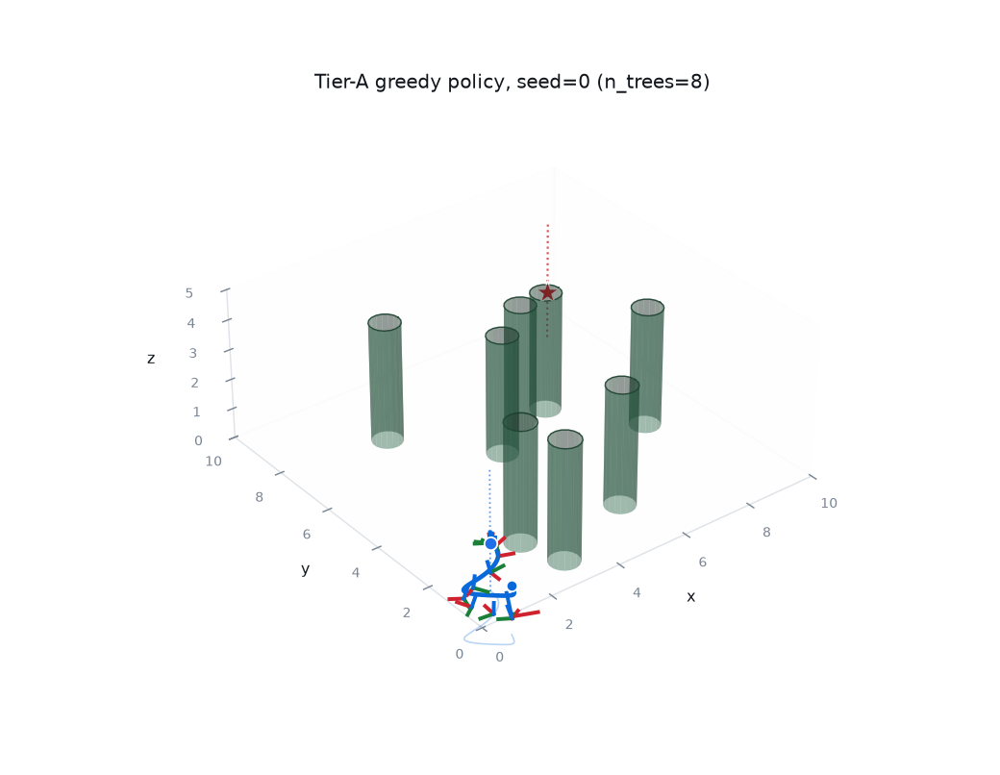
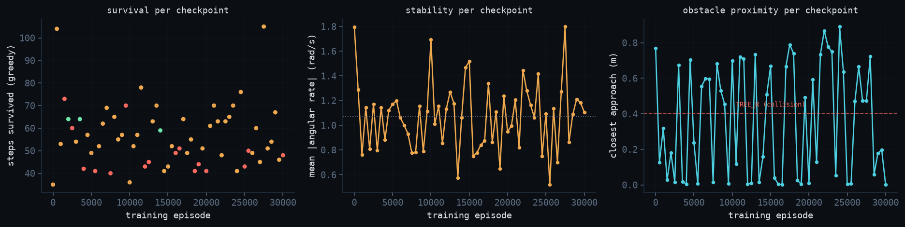
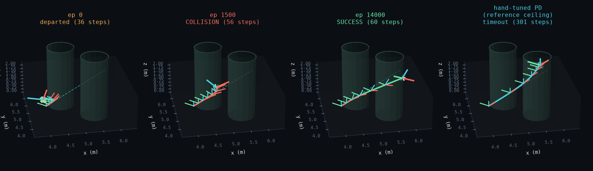
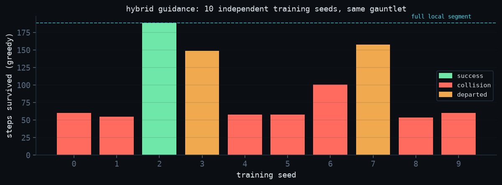
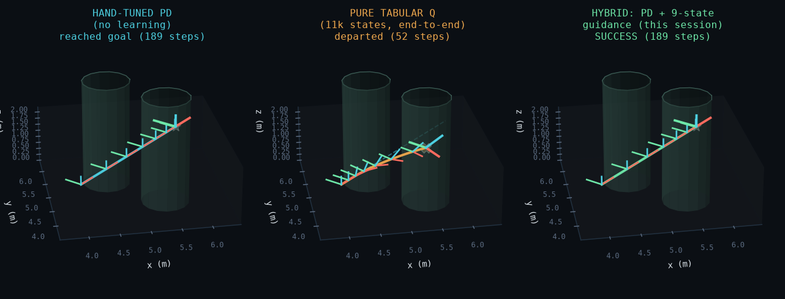
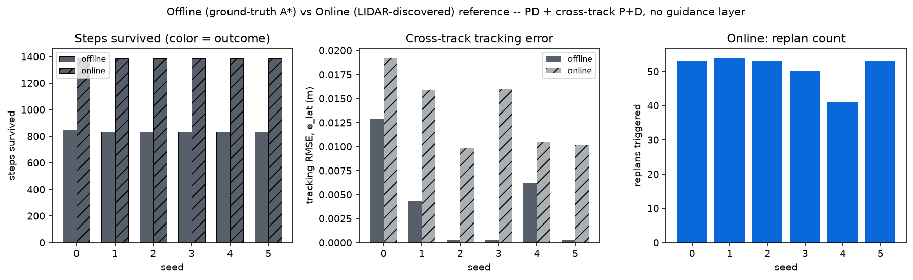
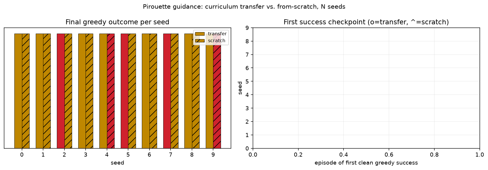

# Tier-A: політ, який заборонила фізика

**AI SkyRun · Tier-A · Звіт про дослідження · 15.07.2026**
*(markdown-копія Артефакту; ілюстрації — файли в цій самій теці `tier_a/reports/`)*

Як ми навчали дрон керувати власною орієнтацією у 6 степенях свободи, сім
разів чесно вимірювали «не вийшло», знайшли справжній баг, і чому
найцінніший результат цього треку — нуль з десяти.

**Коротко:** 133 тести зелені · 7 підходів, кожен виміряний · головний
результат — 0/10 з діагнозом · 1 знайдений реальний баг · усе відтворено
незалежним прогоном 15.07.2026.

---

## 1. Звідки взялася задача

Базовий кіт AI SkyRun — це «шахівниця»: світ порізаний на клітинки 25×25,
дрон телепортується між ними, а табличний Q-learning вчить, у яку клітинку
піти. Це чудова навчальна модель, але вона обходить головне питання
справжньої робототехніки: **а як фізично летіти?**

У базовому кіті ця дірка навіть задокументована: місток до симулятора
(`webots/bridge.py`) перетворює політику на список точок і швидкість, а далі
чесно пише — орієнтацією та висотою хай займається «існуючий PID»… якого в
репозиторії не існує. **Tier-A — це і є той відсутній контролер**, але
побудований не як ручний PID, а як задача навчання з підкріпленням (RL).

> **Словничок.** *PID* — класичний регулятор: керує пропорційно помилці (P),
> її накопиченню (I) та швидкості зміни (D); у нас — спрощений PD.
> *6-DOF* — шість степенів свободи: позиція (x, y, z) + кути крену φ,
> тангажа θ, рискання ψ. *RL* — навчання з підкріпленням: агент діє,
> отримує винагороду/штраф і вчиться максимізувати сумарну винагороду.

## 2. Постановка задачі

Маршрут крізь ліс уже прокладений ідеальним планувальником (A*-«оракул»,
який бачить усю мапу). Завдання агента — **пролетіти цим маршрутом** як
справжнє тверде тіло: на кожному кроці обирати моменти сил навколо трьох
осей.

| | Базовий кіт | Tier-A |
|---|---|---|
| Стан | номер клітинки | неперервний 10-вимірний вектор **помилок трекінгу** |
| Дії | 8 напрямків | 27 комбінацій моментів (3 рівні × 3 осі) |
| Динаміка | телепорт між клітинками | інтеграція твердого тіла у 6-DOF |
| Маршрут | агент шукає сам | готовий від A*; агент має його **відстежити** |
| Тяга | — | **зафіксована на рівні зависання** (ключове рішення!) |

Агент **не бачить** ні координат, ні дерев — лише помилки відносно еталона
(`e_lat, e_alt, e_φ, e_θ, e_ψ, p, q, r, κ`). Це інваріант №2 кіта: *стан —
це досвід, а не мапа*.

> **Ключовий компроміс.** Тягу зафіксували свідомо — щоб простір дій лишився
> маленьким і табличні методи мали шанс. Наприкінці треку саме це стане
> **фізичним вето** — найкраща ілюстрація того, як інженерні компроміси
> повертаються з відсотками.

*Гізмо орієнтації корпусу в польоті: агент керує саме орієнтацією, позиція —
лише її наслідок.*

Відео: `tier_a_blender_flight.mp4` — повне коло за еталонною траєкторією
(Blender-рендер).

## 3. Фізика: чотири закони, які все вирішили

| Закон | Зміст |
|---|---|
| `w(φ) = √((R·cosφ)² + (H·sinφ)²)` | **Ширина у профілі.** Корпус — еліпсоїд (R=0.25 м, H=0.08 м). Крен «стоншує» дрон для щілини: при 85° він утричі вужчий. |
| `a_бічне = g·sinφ` | **Ціна крену.** У прямому польоті з креном бічній складовій тяги ніщо не протистоїть: ~7 м/с² при 45°, ~9.7 при 80° — зносить у стовбур. |
| `T = mg/cosφ` | **Вимога knife-edge.** 1.5× зависання при 47°, 3.9× при 75°. А тяга зафіксована на 1.0×; опора тане як cosφ. |
| `t(75°) ≈ 1.2 с` | **Інерція проти часу.** Докрутитися до 75° з доступними моментами — ~1.2 с; за цей час знос уже виніс дрон із коридору. |

П'ятий закон — про навчання: підказки агенту лише у формі потенціального
шейпінгу `F = γ·Φ(s′) − Φ(s)` з `Φ(термінал)=0` (теорема Нг–Харади–Рассела:
пришвидшує навчання, не змінюючи оптимум). Будь-що інше ризикує навчити
агента полювати за підказкою (reward hacking — у Tier-B зловили три такі
випадки наживо).

## 4. З чого складається трек

| Складова | Файли | Що робить |
|---|---|---|
| Динаміка | `dynamics.py` | інтеграція твердого тіла: матриця повороту, кутові швидкості |
| Середовище | `env.py`, `constants.py` | стан-винагорода-термінали; вітер 5% опційно; `TREE_R` імпортується, не копіюється |
| Еталонна траєкторія | `reference_trajectory.py` | клітинки A* → плавний часовий профіль позиції та орієнтації |
| Сенсори | `lidar2d.py`, `lidar3d.py` | 3D-лідар у **системі тіла** (нахилився дрон — нахилився конус променів); 16 і 64 промені, ~417 мкс/скан |
| Мапування | `mapping.py`, `online_planner.py` | тристанова мапа переконань + повний A*-переплан кожні ~0.5 с |
| Корпус | `occupancy.py` | еліпсоїдна модель зіткнень: `presented_half_width(φ)` |
| Агенти | `agent/*.py` | DQN · Q-таблиця 11k станів · гібрид PD+таблиця · пірует-guidance |
| Оцінювання | `scoring/` | лідерборд: навчився → безпечно → точно → швидко |
| Тести | `tests/` (15 файлів) | 133 тести: інваріанти, фізика, сенсори, агенти, скаффолд |

## 5. Хід роботи: сім підходів, крок за кроком

Кожен крок — гіпотеза, експеримент і чесно записаний результат. Кожна
невдача *звужує* діагноз.

### Крок 1. DQN на векторі помилок — «частково»

«Ванільний» онлайн-DQN виявився **гіршим за випадкову політику** — потрібен
target network. Після нього — реальний прогрес: виживання подвоюється,
скорборд відрізняє навченого від ненавченого. Повне коло на 1200 епізодах —
ні (задокументовано в коді: метрика прогресу — RMSE і виживання).

### Крок 2. 3D-лідар + таблиця на 11k станів — 3/61

Табличний Q-learning без нейромереж на короткій сцені-«gauntlet» (двоє
дерев, просвіт 0.6 м). Сцена **зловила справжній баг**: еталонний тангаж
мав неправильний знак — «ідеальне відстеження» означало летіти хвостом
уперед; PD до фіксу літав задом наперед. Найкращий аргумент за маленькі
контрольовані сцени.

*61 чекпоінт за 30 000 епізодів: 3 успіхи, 16 зіткнень, 42 відльоти — без
гладкої кривої, і це показано чесно.*

*Чотири польоти крізь ті самі ворота: ранній перекидається за 36 кроків;
середній чіпляє стовбур; епізод 14 000 проходить чисто; ручний PD — стеля.*

### Крок 3. Абляція вітру: 8 сідів — 1/8 проти 0/8

Гіпотезу «заважає вітер» перевірили експериментом: без вітру трохи краще,
але картину не змінює. Вузьке місце — **грубість дискретизації** (3 біни
проти неперервного PD), не випадковість.

### Крок 4. Гібрид PD + таблиця з 9 станів — 1/10

PD стабілізує, навчання звужене до одного рішення: куди хилитися, коли лідар
бачить стовбур (стан 3×3, 3 дії).

*1 успіх, 7 зіткнень, 2 відльоти. Маленька таблиця ≠ автоматично надійна.*

Причина: щілина в «небезпечній» зоні лідара лише кілька кроків з ~55–190 за
епізод — критичні стани відвідуються найрідше, а епізод закінчується
зіткненням раніше, ніж вони набирають статистику. Пастка «рідкісних
критичних станів».

*PD / чиста таблиця / гібрид на одних воротах. Успішний гібрид (сід 2)
повторює PD майже точно — ті самі 189 кроків.*

Відео успішного прольоту: `tier_a_hybrid_flight.gif`.

### Крок 5. Online-переплан за лідаром — механізм працює, точність ×3 гірша

Дрон відкриває ліс на льоту, будує мапу переконань, переплановує тим самим
A* кожні ~0.5 с (повний переплан замість D*-Lite — на 625 клітинках
простота виправдана).

*Незнання мапи коштує вимірно: RMSE утричі більший — ціна стрибків еталона
при переплані. 0/6 в обох умовах — «ефект підлоги» чистого PD на повному
колі, а не провал механізму.*

Чесна примітка: «online виживає довше» — артефакт більшого таймаута, а не
перевага. Відео: `tier_a_blender_slalom.mp4`.

### Крок 6. Tier-A+ «пірует»: щілина, вужча за корпус — 0/10 + 0/10

Ворота вужчі за розмах (0.65 м рівного профілю), але ширші за товщину на
ребрі (0.48 м): геометрія каже «нахилися на 75° — пролізеш». Побудовано:
64-променевий лідар, еліпсоїдні зіткнення, guidance-таблиця 9×7 поверх PD,
курикулум прямо → 47° → 75°, transfer і from-scratch, по 10 сідів.

*0/10 перенесення, 0/10 з нуля; жодного успішного чекпоінта за 3000
епізодів фінальної стадії в жодному сіді.*

### Крок 7. Діагноз зондами: це вето, а не невдача

Скриптовані політики без жодного навчання:

| Зонд | Результат |
|---|---|
| Крен до 85° при спрацюванні лідара | ЗІТКНЕННЯ — до воріт докрутився лише до ~46° |
| Крен до 80°, тригер за 2.4 м | ВІДЛІТ — накренений дрон зісковзує з коридору |
| Те саме без коридору допуску | знесло на 30+ м, до воріт не долетів |
| Пряма стадія (0.75 м, без крену) | УСПІХ — «сантехніка» справна |

**Жодна політика — ні навчена, ні скриптована — пройти не може.** Бічна
сила g·sinφ без протидії, опора cosφ, 1.2 с до 75° крену, потрібно
T = mg/cosφ до 3.9× — а тяга зафіксована. **0/10 — це середовище каже
правду, а не RL не знайшов відповідь.**

## 6. Незалежне відтворення (прогін 15.07.2026)

| Блок | Команда | Результат | Вердикт |
|---|---|---|---|
| Тести | `pytest tier_a/tests` | 132 passed, 1 skipped (torch-скіп за дизайном) | збіглося |
| Кеш еталонів | `scoring.precompute_attitude` | 18/18 feasible, Lref 11.31–11.72 м, байт-у-байт | збіглося |
| Лідерборд | `scoring.harness_attitude --public` | success 0.00 у всіх; ранжування за безпекою/точністю працює | збіглося |
| Online-переплан | `compare_online_planning` | 0/6 і 0/6; RMSE 0.004 проти 0.014 (×3.5) | якісно збіглося |
| Пірует | `report_pirouette_curriculum --seeds 10` | **0/10 і 0/10** — точне відтворення | збіглося |
| Скаффолд | `validate_team_attitude --smoke` | 0/8 на smoke-бюджеті — так і задекларовано | збіглося |

Побічна знахідка: після реструктуризації три скрипти мали зламаний
`sys.path` (падали при запуску як скрипт, працювали через `python -m` —
тому тести не бачили). Виправлено і перевірено. Урок: **entry-point'и треба
перевіряти так, як їх запускає користувач.**

Числа online-експерименту трохи інші, ніж у README — таблиця README
писалася до коміту, що змінив модель зіткнень; якісний висновок ідентичний.
Протокол прогону: `tier_a_run_report.md`.

## 7. Глибокий аналіз: що так, що ні, і чи це найкраще рішення

### Що було зроблено правильно

| Рішення | Чому це правильно |
|---|---|
| Інваріанти як тести | «Стан = досвід», Φ(термінал)=0, один TREE_R — перевіряються кодом, порушення не пройде CI |
| Культура чесного нуля | 1/8, 1/10, 3/61, 0/10 опубліковані з діагнозами; «майже працює» не видане за результат |
| Зонди-оракули | Відокремити «RL не навчився» від «фізично неможливо» можна лише політикою без навчання; чотири зонди перетворили нуль на теорему |
| Контрольовані абляції | Вітер перевірений на 8 сідах, а не «здався зайвим» |
| Маленькі сцени (gauntlet) | Зловили реальний баг знаку тангажа, невидимий на повному колі |
| Найпростіший коректний механізм | Повний A*-переплан замість D*-Lite; бюджет — у тести й анкерування |
| Target network у DQN | Виміряно (без нього гірше за random) і записано в docstring |

### Що було зроблено не так (або далося дорого)

| Проблема | Чесна оцінка |
|---|---|
| Фіксована тяга | Свідомий тайм-бокс, який зробив фінальну задачу нерозв'язною. Мінус: пів треку на забороненому маневрі. Плюс: заборону виміряно точно і вона стала ТЗ Tier-B. Помилка планування, конвертована в результат |
| 3-бінова дискретизація | Головний стельовий фактор усіх табличних підходів; передбачувано *до* експериментів — частину прогонів можна було зекономити |
| Стрибки еталона при переплані | Анкерування знизило найгірший стрибок зі ~180° до 40–130°; до бажаних <15° далеко — «частковий фікс» |
| Success на повному колі | Метрика лежить на підлозі (PD не проходить коло навіть з мапою) і нічого не розрізняє; RMSE треба було зробити основною раніше |
| Баг знаку тангажа | Конвенції системи координат треба тестувати першими, окремим тестом на кожен знак |
| Зламані entry-point після реструктуризації | Тести покривали імпорти модулів, але не запуск файлів як скриптів |

### Чи це об'єктивно найкраще рішення?

**Ні — і це задокументовано чесно.** Для неперервного 6-DOF керування
табличний Q-learning і дискретизований DQN об'єктивно поступаються методам
з неперервними діями (PPO, SAC). Доказ — Tier-B: SAC з неперервним
CTBR-керуванням **пройшов** щілину 0.26 м із креном 35–49°, тобто виконав
саме той маневр, який тут не вдався.

Але «найкраще для маневру» ≠ «найкраще для задачі треку». Мета Tier-A —
навчальна й діагностична: показати *межі* табличних методів на чесній
фізиці в рамках інваріантів кіта (без нейромереж у ядрі, стан = досвід).
У цих рамках вибір виправданий, а стеля — виміряна, а не вгадана.
Найцінніше: трек **перетворив свою межу на точну специфікацію наступного
кроку** — «тяга має стати четвертим каналом дії». Це і є науковий спосіб
помилятися.

## 8. Що вдосконалювати і над чим ще працювати

- **Алгоритмічні важелі DQN**: double DQN, n-step returns, курикулум за
  n_trees/швидкістю — названі в README, не виміряні; кожен — окремий
  експеримент на 8+ сідах.
- **Контролер повного кола**: зняти «ефект підлоги» (guidance поверх PD або
  PD з випередженням за кривизною) — інакше online/offline порівняння не
  покаже головного.
- **Плавний переплан**: cross-fade двох еталонів або короткий MPC-місток
  проти стрибків 40–130° — найбільша відома недоробка online-треку.
- **Рідкісні критичні стани**: prioritized replay для таблиці або штучне
  продовження епізоду повз ворота (загальна проблема safe-RL).
- **Статистика**: 20+ сідів з довірчими інтервалами замість 8–10; скрипти
  вже multi-seed-ready.
- **Тяга як 4-й канал**: реалізовано як Tier-B (CTBR до 2g, PPO проти SAC);
  відкрита частина там — щілини 0.20/0.16/0.12 м за бюджетом 2M кроків.

## 9. Підсумок: куди це привело

Tier-A не «переміг» свою фінальну задачу — і саме тому він вдався. Трек
побудував повний дослідницький конвеєр (динаміка → сенсори → агенти →
скорборд → тести), сім разів чесно виміряв межу табличних методів на
справжній фізиці, зловив один реальний баг і завершився **точно
сформульованою фізичною передумовою**: щоб пролетіти щілину боком, дрону
потрібна керована тяга.

Ця передумова стала першим рядком специфікації Tier-B — де дрон з
неперервним керуванням тягою, навчений SAC, нарешті зробив пірует: крен до
49.5° у щілині 0.26 м при ширині корпусу 0.24 м. Ланцюжок «чесний нуль →
діагноз → нова постановка → успіх» і є головним експонатом проєкту.

---

*Першоджерела: `tier_a/env_attitude/README.md` (повна історія кожного
підходу), `tier_a/CONCEPT.md` (концепт завдання), `tier_a/reports/tier_a_run_report.md`
(протокол прогону 15.07.2026). Інтерактивна версія цього звіту з відео —
Артефакт: https://claude.ai/code/artifact/e837e049-3525-420d-a4b1-b6cf426e6ff5*
